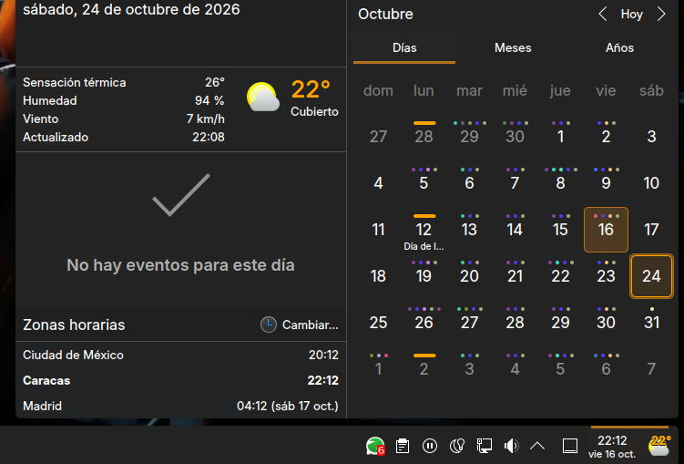

# City Weather & Time

A Plasma 6 applet that shows the **current weather and the local wall-clock
time of any city**, using the free [Open-Meteo](https://open-meteo.com) public
APIs (no API key needed).



- City time is shown in the city's own timezone, using the UTC offset that
  Open-Meteo reports for it (daylight-saving changes are picked up on the next
  weather refresh).
- Current conditions on refresh: temperature, feels-like, humidity, wind speed,
  weather condition and icon.
- Compact panel form (time, date, icon, temperature) and a tooltip with the
  weather details. Every element can be turned off in the settings.
- Clicking the widget opens a calendar, like the Digital Clock applet. Enable
  event plugins (holidays, PIM events, astronomical events…) in
  **Configure… → Calendar** to show the agenda of the selected day.
  The popup also lists world clocks (the city's time zone plus the ones added
  in **Configure… → Time Zones**, like the Digital Clock) and the current
  weather.
- Right-click → **Refresh weather** fetches the weather immediately.
- Nothing leaves your machine except the two Open-Meteo requests.

## Requirements

- KDE Plasma 6 (the metadata requires `X-Plasma-API-Minimum-Version: 6.0`).
- Internet access to `api.open-meteo.com` and `geocoding-api.open-meteo.com`.
- `kpackagetool6` (provided by the `kpackage` package).

## Quick start

Install the latest release: download the `.plasmoid` file from the
[releases page](https://github.com/calvarad0/plasmoide-time/releases) and run:

```sh
kpackagetool6 --type Plasma/Applet --install org.plasma.citytimeweather-<version>.plasmoid
systemctl --user restart plasma-plasmashell
```

Or install from a checkout (run from this directory — the repository root IS
the package):

```sh
kpackagetool6 --type Plasma/Applet --install .
systemctl --user restart plasma-plasmashell
```

Restarting the shell makes the widget appear in the list and loads its
translations; without it the widget may show up in English.

Then right-click the desktop (or a panel) → **Add Widgets** → search for
**City Weather & Time** → click to add.

Configure: right-click the widget → **Configure…** and set the city name.

Update after a change (or to a newer `.plasmoid`), then restart the shell:

```sh
kpackagetool6 --type Plasma/Applet --upgrade .
systemctl --user restart plasma-plasmashell
```

Remove: first remove the widget from the desktop and panels, then:

```sh
kpackagetool6 --type Plasma/Applet --remove org.plasma.citytimeweather
systemctl --user restart plasma-plasmashell
```

## Configuration

| Setting            | Key             | Default        | Notes                                  |
| ------------------ | --------------- | -------------- | -------------------------------------- |
| City name          | `city`          | `Caracas`      | Free text; resolved via geocoding      |
| Temperature units  | `units`         | `c`            | `c` = Celsius, `f` = Fahrenheit        |
| Time format        | `timeFormat`    | `24`           | `24` = 24-hour, `12` = 12-hour         |
| Refresh interval   | `refreshMinutes`| `15`           | Weather only; 5–120 minutes            |
| Show time          | `showTime` | `true` | Panel |
| Show date          | `showDate` | `true` | Panel; shown under the time |
| Show weather icon  | `showWeatherIcon` | `true` | Panel |
| Show temperature   | `showTemperature` | `true` | Panel |
| Show condition     | `showCondition` | `true` | Tooltip |
| Show feels like    | `showFeelsLike` | `true` | Tooltip |
| Show humidity      | `showHumidity` | `true` | Tooltip |
| Show wind          | `showWind` | `true` | Tooltip |
| Show last updated  | `showUpdated` | `true` | Tooltip |
| Show tooltip       | `showTooltip` | `true` | Tooltip on hover |
| Temp. size (panel) | `tempFontSizePanel` | `10` | Points; 6–48 |
| Temp. size (desktop) | `tempFontSizeDesktop` | `12` | Points; 6–48 |
| Show week numbers  | `showWeekNumbers` | `false` | Calendar |
| First day of week  | `firstDayOfWeek` | `-1` | Calendar; `-1` = region default |
| Event plugins      | `enabledCalendarPlugins` | empty | Calendar agenda |
| Time zones         | `selectedTimeZones` | `Local` | World clocks in the popup |

The temperature unit also drives the wind speed unit (km/h vs mph). The time
format affects the compact view, the tooltip and the agenda. The calendar's
"today" follows the configured city's date.

## How it works

1. On startup and whenever the city changes: geocode the city name via
   `geocoding-api.open-meteo.com` → coordinates + IANA timezone.
2. Fetch `current` weather for those coordinates via `api.open-meteo.com`
   (temperature, apparent temperature, humidity, wind speed, WMO weather code).
3. The wall clock adds the forecast's `utc_offset_seconds` to the current UTC
   time. Until the first successful fetch it shows the system time. No KDE
   clock module is required, so it works on every Plasma 6 release.
4. A timer re-fetches the weather every `refreshMinutes`, pausing while a
   request is already in flight.

## Layout

```
metadata.json              Package metadata (KPlugin block + Plasma keys)
contents/config/config.qml Configuration dialog: category list
contents/config/main.xml   KConfigXT schema (defaults, ranges, choices)
contents/ui/main.qml       Applet UI: PlasmoidItem root, compact view, tooltip
contents/ui/CalendarView.qml   Popup: date, weather, agenda, time zones, month
contents/ui/WeatherDetails.qml Weather block shared by the tooltip and popup
contents/ui/TimeZonesView.qml  World clocks shown in the popup
contents/ui/js/weather.js  Logic: Open-Meteo requests + WMO code mapping
contents/ui/configGeneral.qml  Configuration page (general settings)
contents/ui/configCalendar.qml Configuration page (calendar, event plugins)
contents/ui/configTimeZones.qml Configuration page (time zones)
contents/locale/           Compiled translations (.mo), loaded by Plasma
po/                        Translation sources (.po) and helper scripts
```

## Translations

The UI follows the desktop language. Spanish (`es`) is included; anything
without a translation falls back to English. City and country names come from
Open-Meteo in the desktop language when it supports it.

After changing translatable strings (requires gettext):

```sh
po/extract.sh   # refresh po/template.pot and merge it into po/*.po
# edit po/<lang>.po
po/build.sh     # compile into contents/locale/<lang>/LC_MESSAGES/
```

To add a language, copy `po/es.po` to `po/<lang>.po`, translate it and run
`po/build.sh`. Commit both the `.po` and the generated `.mo`.

## Credits & license

- Weather data: [Open-Meteo](https://open-meteo.com) (CC-BY 4.0).
- This widget: GPL-2.0-or-later, © Carlos Alvarado.
- The calendar popup, the time zones list and the Calendar and Time Zones
  settings pages are adapted from the **Digital Clock** applet of KDE
  [plasma-workspace](https://invent.kde.org/plasma/plasma-workspace)
  (`applets/digital-clock`, Plasma 6.3), © its KDE authors. Each adapted file
  keeps its original copyright notices and license in its header:
  `GPL-2.0-or-later`, or `GPL-2.0-only OR GPL-3.0-only OR
  LicenseRef-KDE-Accepted-GPL` for the settings pages and `config.qml`.
- The time zones list relies on the Digital Clock's private QML module
  (`org.kde.plasma.private.digitalclock`), installed with Plasma. It is not a
  stable API: if a Plasma release changes it, only the time zones section
  disappears.

## Known caveats

- Requires Plasma 6; the widget will not appear in the Plasma 5 widget list.